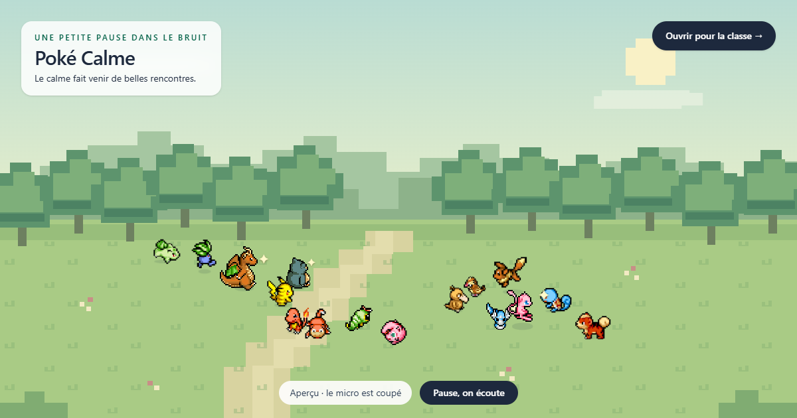

# Poké Calme

Une clairière Pokémon pour accompagner le travail calme en CP.
Adaptation indépendante de [Shy Safari](https://github.com/teacherdotdev/shy-safari).

16 Pokémon Donjon Mystère se promènent dans huit directions, font de petites
pauses et regardent la classe lorsque l’enseignante prend la parole.

## Pour la classe

- Premier compagnon après 10 à 20 secondes de calme, puis environ toutes les
  deux minutes par défaut. Le rythme et le seuil sont réglables.
- Par défaut, le bruit suspend les rencontres sans retirer les Pokémon gagnés.
- Pause avec le bouton ou la touche **Espace**, minuteur, consignes et collection.
- Plusieurs groupes, avec leurs rencontres et leurs notes conservées séparément.
- Démonstration sans micro et sans effet sur la progression de la classe.
- Apparition depuis les hautes herbes, avec bruissement et bulle d’exclamation.
- Rares siestes de 30 à 120 secondes avec les sprites de sommeil d’origine.
  Dans la démo, « Une nouvelle rencontre » et « Voir une sieste » permettent
  de les essayer immédiatement. Le bouton Pause réveille les Pokémon.
- Français au premier lancement ; interfaces anglaise et espagnole disponibles.
- Aucun compte, publicité ni outil de mesure d’audience. Le son reste sur l’appareil.
- Site publié utilisable hors connexion après sa première préparation complète.



## Démarrer dans WebStorm

Sous Windows, double-cliquer sur **DEMARRER.cmd**. Le lanceur utilise Bun,
ou le prépare avec Node.js si nécessaire. Le premier lancement demande une
connexion Internet. Aucun outil n’est installé globalement par le lanceur.

Une fois les dépendances installées, WebStorm propose la configuration
partagée **Poké Calme** dans la liste Exécuter. Le bouton à côté du script
`dev` dans `package.json` fonctionne aussi.

Avec [Bun](https://bun.sh/docs/installation) :

```sh
bun install --frozen-lockfile
bun run dev
```

Ouvrir l’adresse affichée. Garder le serveur ouvert pendant l’utilisation
locale ; `Ctrl+C` l’arrête. Le microphone demande HTTPS ou localhost.

## Publier et personnaliser

Le **[guide GitHub](GUIDE-GITHUB.md)** explique le travail avec ton fork et
la première publication sur GitHub Pages. Les chemins sont calculés
automatiquement, même si le dépôt est renommé.

| Modification                                       | Fichier                                              |
| -------------------------------------------------- | ---------------------------------------------------- |
| Pokémon, noms et rareté                            | `src/lib/scenes/pokemon/catalog.ts`                  |
| Import des seules animations utiles et des crédits | `bun run sprites:import`                             |
| Touffe de hautes herbes                            | `src/lib/scenes/pokemon/effects/grass-tuft.svg`      |
| Déplacements                                       | `src/lib/scenes/pokemon/walk.ts`                     |
| Fréquence et durée des siestes                     | `src/lib/scenes/pokemon/nap.ts`                      |
| Déroulement d’une apparition                       | `src/lib/scenes/pokemon/encounter.ts`                |
| Décor                                              | `src/lib/scenes/pokemon/backdrop.svg` et `scene.css` |
| Réglages par défaut                                | `src/lib/settings/settings.svelte.ts`                |
| Textes Pokémon                                     | `src/lib/i18n/pokemon.ts`                            |
| Publication                                        | `.github/workflows/pages.yml`                        |

Les anciens décors de Shy Safari restent disponibles. Les PNG Pokémon et
leurs métadonnées sont inclus dans le projet : aucune API n’est appelée en classe.

Les planches utilisées à l’écran ajoutent des marges transparentes entre les
images pour éviter les lignes parasites aux tailles intermédiaires. Les
originaux restent dans `assets/` ; `bun run sprites:pad` régénère les copies
dans `atlases/`, sans téléchargement. L’import des sprites les prépare aussi.

## Vérifier une modification

```sh
bun run check
bun test
bun run lint
bun run build
bunx playwright install chromium
bun run test:browser
```

Le test de navigateur démarre et arrête son propre aperçu. Il utilise un
microphone simulé et ne demande pas d’accès au vrai micro. Il vérifie aussi
le mode hors connexion. La préparation Chromium n’est nécessaire qu’une fois.
Le workflow GitHub effectue ces vérifications avant de publier.

## Crédits et droits

Code Apache 2.0 : [LICENSE.txt](LICENSE.txt), [NOTICE.md](NOTICE.md).
Sprites [PMDCollab / SpriteCollab](https://github.com/PMDCollab/SpriteCollab) :
[crédits détaillés](static/credits/pmd/CREDITS.md), avec les droits propres
des contributions communautaires et des sprites officiels crédités CHUNSOFT.
La touffe actuelle est un dessin SVG original. Sources des premières herbes,
issues de Pokémon Émeraude via pret/pokeemerald :
[source et crédits](static/credits/emerald/CREDITS.md).

L’absence de publicité ne donne pas automatiquement le droit de publier
les images Pokémon. La licence du code et la politique communautaire ne
remplacent pas les droits des titulaires de Pokémon. Projet de fan non officiel.

Le README d’origine est conservé dans
[docs/SHY-SAFARI-README.md](docs/SHY-SAFARI-README.md).
