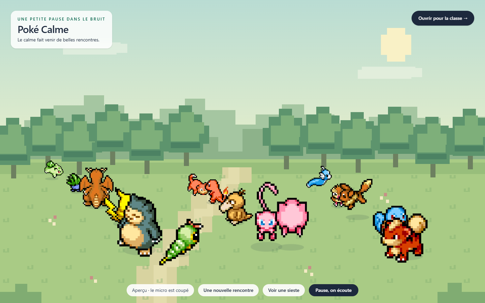

# Poké Calme

**Le calme fait venir de belles rencontres.**

Une application pensée pour accompagner les temps de travail en classe de CP.
Le niveau sonore de la salle pilote l’arrivée de Pokémon dans une clairière
animée, à afficher sur un écran ou un vidéoprojecteur.

[Utiliser en classe](#utiliser-en-classe) · [Démarrer le projet](#démarrer-le-projet) · [Personnaliser](#personnaliser) · [Publier](#publier-sur-github-pages)



## Le principe

- Le temps calme permet de rencontrer de nouveaux Pokémon.
- Dans une clairière vide, le premier arrive après **10 à 20 secondes de calme**.
- Les suivants arrivent environ **toutes les deux minutes** par défaut. Le
  rythme et la sensibilité du micro sont réglables.
- Avec le réglage par défaut, le bruit suspend la progression et immobilise
  les Pokémon, sans retirer ceux que la classe a déjà gagnés.
- Le bouton **Pause** permet à l’enseignante de prendre la parole. Les Pokémon
  se tournent vers la classe et les éventuels dormeurs se réveillent.

## Une clairière vivante

Les **16 Pokémon** utilisent les sprites de style **Donjon Mystère** :
Bulbizarre, Salamèche, Carapuce, Chenipan, Roucool, Pikachu, Rondoudou,
Mystherbe, Psykokwak, Caninos, Ramoloss, Évoli, Ronflex, Minidraco, Dracolosse et Mew.

- Promenades dans huit directions, avec une taille qui suit la perspective.
- Apparitions depuis une grande touffe d’herbe qui se balance, précédées
  d’une bulle « ! ».
- Petites pauses et rares siestes de **30 secondes à 2 minutes**, avec les
  animations de sommeil d’origine.
- Collection des rencontres, plusieurs groupes, minuteur et consignes à afficher.

Les autres décors animaliers hérités de Shy Safari restent disponibles.

## Utiliser en classe

1. Ouvrir l’application et cliquer sur **Commencer**.
2. Autoriser le microphone dans le navigateur.
3. Dans **Réglages**, choisir le micro et ajuster le seuil au niveau sonore
   de l’activité. **Étalonner** aide à prendre un repère de silence puis de conversation.
4. Laisser la clairière affichée pendant le travail. Les rencontres se font
   au fil du temps calme.
5. Pour parler à la classe, utiliser **Pause** ou la touche **Espace**,
   puis reprendre la séance.

Le niveau affiché est un repère relatif, pas une mesure en décibels certifiés.
Les réglages sont à adapter à la salle et au microphone utilisés.

### Essayer sans microphone

Depuis l’accueil, **Découvrir sans micro** ouvre une démonstration indépendante,
également accessible à l’adresse `/demo/` du site.

Les boutons **Une nouvelle rencontre** et **Voir une sieste** permettent
d’essayer les animations immédiatement. Cette démonstration ne remplit pas
la collection de la classe.

## Démarrer le projet

### Sous Windows

Double-cliquer sur **[DEMARRER.cmd](DEMARRER.cmd)** à la racine du projet.
Le lanceur installe les dépendances et ouvre le navigateur.

Il faut disposer de **Bun**, ou de **Node.js** pour que le lanceur prépare
Bun automatiquement. Le premier lancement demande une connexion Internet.
Garder la fenêtre du lanceur ouverte pendant l’utilisation ; `Ctrl+C` arrête le serveur.

### Dans WebStorm ou un terminal

Le projet utilise **Svelte 5, SvelteKit, TypeScript, Vite et Tailwind CSS**.
Les vérifications GitHub utilisent **Node.js 24** et **Bun 1.4.4** ; la version
minimale de Node.js déclarée par le projet est 22.12.

```sh
bun install --frozen-lockfile
bun run dev
```

Ouvrir l’adresse indiquée dans le terminal. Le micro fonctionne sur `localhost`
pour le développement et sur un site servi en HTTPS pour une utilisation hébergée.

Dans **WebStorm**, ouvrir le dossier contenant `package.json`, puis choisir
la configuration partagée **Poké Calme** dans la liste Exécuter. On peut aussi
lancer le script `dev` depuis `package.json`. Les modifications de code se
reflètent dans le navigateur pendant le développement.

## Données et utilisation hors connexion

- **Aucun compte, publicité ou outil de mesure d’audience.**
- Le son est analysé dans le navigateur pour estimer le niveau sonore ; il
  n’est ni enregistré ni envoyé à un serveur.
- Groupes, réglages, notes et collection sont conservés dans le navigateur,
  sur l’appareil utilisé. Ils ne se synchronisent pas entre ordinateurs.
- Les images et leurs métadonnées sont fournies avec le projet : aucune API
  Pokémon n’est appelée pendant une séance.

Sur la version compilée ou publiée, attendre le message
**Prêt pour une utilisation hors connexion** lors d’une première ouverture
avec Internet. L’application peut ensuite être rechargée sans réseau et
installée depuis un navigateur compatible.

Supprimer les données du site efface les sauvegardes locales. En développement,
le serveur lancé depuis WebStorm ou le terminal doit rester ouvert.

## Personnaliser

| Pour modifier…                       | Fichier                                                                                                                          |
| ------------------------------------ | -------------------------------------------------------------------------------------------------------------------------------- |
| Les Pokémon et leur rareté           | [catalog.ts](src/lib/scenes/pokemon/catalog.ts)                                                                                  |
| Les déplacements et la perspective   | [walk.ts](src/lib/scenes/pokemon/walk.ts)                                                                                        |
| La fréquence et la durée des siestes | [nap.ts](src/lib/scenes/pokemon/nap.ts)                                                                                          |
| Les étapes d’une apparition          | [encounter.ts](src/lib/scenes/pokemon/encounter.ts) et [PokemonEncounter.svelte](src/lib/scenes/pokemon/PokemonEncounter.svelte) |
| La touffe d’herbe                    | [grass-tuft.svg](src/lib/scenes/pokemon/effects/grass-tuft.svg)                                                                  |
| Le décor et son apparence            | [backdrop.svg](src/lib/scenes/pokemon/backdrop.svg) et [scene.css](src/lib/scenes/pokemon/scene.css)                             |
| Les réglages par défaut              | [settings.svelte.ts](src/lib/settings/settings.svelte.ts)                                                                        |
| Les noms et textes Pokémon           | [pokemon.ts](src/lib/i18n/pokemon.ts)                                                                                            |

### Préparer les sprites

Après un changement du catalogue, cette commande télécharge les animations
**Idle, Walk et Sleep**, leurs métadonnées et leurs crédits depuis la révision
de SpriteCollab fixée dans le script :

```sh
bun run sprites:import
```

Les originaux sont conservés dans `src/lib/scenes/pokemon/assets/`. Les copies
utilisées à l’écran sont générées dans `atlases/`, avec des marges transparentes
entre les images pour empêcher les cases voisines de déborder lors des changements de taille.

Pour régénérer uniquement ces copies, sans téléchargement :

```sh
bun run sprites:pad
```

Chaque animation conserve ses dimensions, ses durées et son nombre réel de
directions. Les planches de sommeil des 16 Pokémon actuels utilisent leur
unique orientation native.

## Vérifier les modifications

```sh
bun run check
bun test
bun run lint
bun run build
```

Pour les tests dans le navigateur, préparer Chromium une première fois :

```sh
bunx playwright install chromium
bun run test:browser
```

La version compilée doit être construite avant `test:browser`. Ce script
démarre son propre aperçu, utilise un micro simulé et vérifie notamment les
rencontres, la marche, le découpage des sprites, les siestes, le clavier,
la sauvegarde et le fonctionnement hors connexion.

## Publier sur GitHub Pages

Poké Calme se compile en **site statique**, sans backend à héberger.
Le workflow [Vérifier et publier](.github/workflows/pages.yml) est fourni :

- Les demandes de fusion vers `main` exécutent les vérifications.
- Les changements envoyés sur `main` exécutent les vérifications, puis
  publient le site lorsque GitHub Pages est configuré pour ce dépôt.
- Les chemins des images et du mode hors connexion suivent le chemin du dépôt.

Le **[guide GitHub et WebStorm](GUIDE-GITHUB.md)** détaille la préparation du
fork, les commits, l’activation de Pages et la première publication.

## Origine, crédits et licence

Poké Calme est une adaptation indépendante de
[Shy Safari](https://github.com/teacherdotdev/shy-safari), créé par teacherdotdev / teacher.dev.

- **Code** : licence [Apache 2.0](LICENSE.txt). Les modifications et les
  mentions d’origine sont décrites dans [NOTICE.md](NOTICE.md).
- **Sprites Pokémon** : [PMDCollab / SpriteCollab](https://github.com/PMDCollab/SpriteCollab).
  Les [crédits par Pokémon](static/credits/pmd/CREDITS.md) et la
  [licence du dépôt de sprites](static/credits/pmd/LICENSE.md) sont conservés,
  y compris les mentions CHUNSOFT des sprites officiels.
- **Clairière, touffe d’herbe et éléments d’interface propres à l’adaptation** :
  dessins SVG réalisés pour Poké Calme.

Projet de fan non officiel, sans affiliation avec Nintendo, Creatures,
GAME FREAK ou The Pokémon Company. La licence du code ne s’étend pas aux
images, personnages et marques Pokémon ; voir les précisions dans [NOTICE.md](NOTICE.md).

Le [README d’origine de Shy Safari](docs/SHY-SAFARI-README.md) est conservé dans le dépôt.
